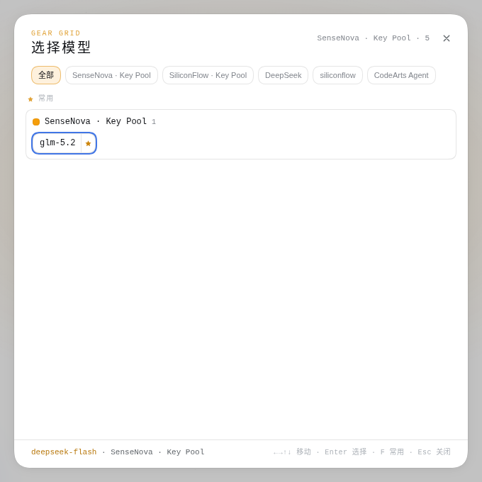
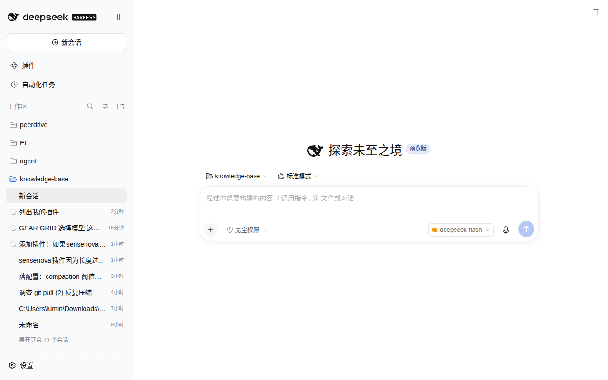
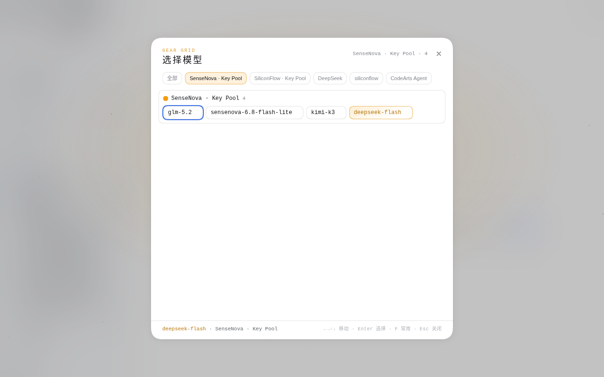

# Gear Grid 模型选择器（Gear Grid Model Picker）

**dsh-gear-grid-model** —— DeepSeek Harness（DSH）客户端 UI 插件，把输入框的模型选择座位换成 **Gear Grid（2D Cosmic Shifter）** 风格转盘。点一下，从星野弹窗里一次选好模型与推理等级。

> 把默认的模型下拉换成宇宙网格选择器：**「常用」** 只显示你手动 star 的常用模型（按 provider 分组），点具体 provider 才看它的全部可用模型；`/` 聚焦搜索框可按模型名跨 provider 过滤。



---

## 功能特性

- **Gear Grid 座位** —— 输入框的模型座位变成 28px 药丸触发器，显示当前模型 + 思考强度 + 箭头。
- **星野弹窗** —— 点药丸弹出全屏宇宙弹窗（「GEAR GRID · 选择模型」），带闪烁星野。
- **「常用」tab（收藏）** —— 只显示你用 ☆ / `F` 手动收藏的模型，按 provider 分组；还没收藏时有提示教你怎么加常用。
- **搜索框** —— `/` 聚焦搜索框，按模型名/id 全局过滤（所有 provider 一起搜，结果仍按 provider 分块）。
- **provider tab** —— 每个 provider 一个 tab（如 *SenseNova · Key Pool*、*SiliconFlow · Key Pool*、*DeepSeek*、*CodeArts Agent*），显示该 provider 的全部可用模型（分组）。
- **药丸 = 模型 + 思考强度分段** —— 每个模型一颗完整药丸：名字 + 思考强度分段（有适配器声明 efforts 的模型才有）+ ☆；点分段设推理等级，一次点击同时定好模型与等级。
- **键盘友好** —— `←` `→` `↑` `↓` 移动焦点环，`Enter` 选择，`F` 收藏，`/` 聚焦搜索框，`Esc` 关闭。
- **provider 颜色可自选** —— 默认颜色由 provider id 哈希到四档主题色；**点 provider 块头的 8px 色点**可以改：四档预设 + 原生取色器（任意颜色）+「自动」回退，覆盖存 localStorage。
- **跟随主题** —— 视觉只用 DSH 主题令牌（`--dsw-*`），宇宙色相用 `color-mix` 派生，自动跟随明暗色板。

## 截图

| 状态 | 说明 |
|---|---|
|  | **01 · 收起** —— 输入框模型座位变成药丸触发器，显示当前模型（此处 `deepseek-flash`）+ 箭头。点它打开选择器。 |
|  | **02 · 弹窗，常用 tab** —— 星野弹窗。**「常用」** 显示已 star 的常用模型（按 provider 分组，此处已收藏 `DeepSeek-V4-Pro`，组头「DeepSeek · 1」）；底部显示当前选择（`deepseek-flash`）与键盘提示。 |
|  | **03 · provider 网格** —— *DeepSeek* tab 显示该 provider 的全部模型（组头「DeepSeek · 3」），每个模型是一颗药丸（名字 + 思考强度分段 Off/Low/High/Max + ☆），`DeepSeek-V4-Pro` 已收藏点亮。 |

## 要求

- DeepSeek Harness（`dsh`），且为 **web** 客户端（本插件纯浏览器端）。

## 安装

```bash
# 从 npm 安装（发布后）
dsh plugin --profile web add dsh-gear-grid-model

# 或本地开发（link 方式）
# 编辑 ~/.dsh/profiles/web/package.json，添加：
#   "dsh-gear-grid-model": "link:/home/lumin/.dsh/plugins/dsh-gear-grid-model"
dsh --profile web
```

装完重启 `dsh`。插件通过 `package.json` 的 `dsh.bundle.patch`（`cordis.patch.yml`）与 `dsh.client` 自声明为客户端 bundle，会被 web 客户端的模块扫描器自动拾取。

## 使用

1. **打开** —— 点输入框右上角的药丸触发器（显示当前模型）。
2. **浏览** —— **「常用」** tab 显示你 star 的常用模型（按 provider 分组）；点某个 provider tab 显示它的全量模型；按 `/` 聚焦搜索框可按名字过滤。
3. **收藏常用** —— 把鼠标移到模型上点 ☆（或按 `F`）。收藏的模型进 **「常用」**，按 provider 分组。
4. **选择** —— `←→↑↓` 移动焦点环，`Enter` 选择（或点药丸/思考强度分段）。一次设好模型与推理等级。
5. **关闭** —— `Esc` 或点外面。

## 工作原理

- **纯客户端 UI 插件** —— 宿主半（`index.js`）是空 `apply()`；全部行为在 `client.js`，单文件自含（无外部 import）。
- **复用原生模型数据** —— 读 `ctx.modelDirectories`，与 `/model` 命令、原生座位同源，不重复维护 provider/模型知识。
- **原生座位折叠而非卸载** —— 原始模型座位留在树里但隐藏，不破坏其它依赖它的东西。
- **`package.json` 声明** —— `dsh.bundle.patch` → `./cordis.patch.yml`；`dsh.client`（platform `web`，`inject` locale + model-selection 模块）。

## 开发

- `verify.cjs` —— 小型校验脚本（断言客户端 bundle 与 boot 图包含本插件）。
- `locale/{en,zh}.json` —— UI 文案（标题 + 描述），英/中。

## 许可证

MIT（见 [LICENSE](LICENSE)）。
